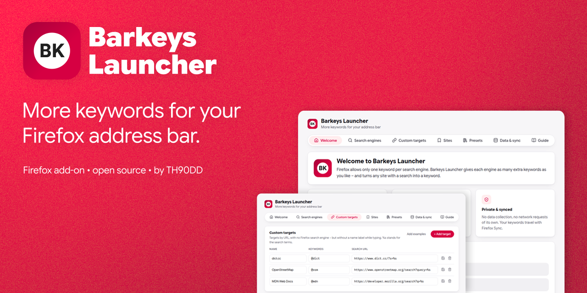
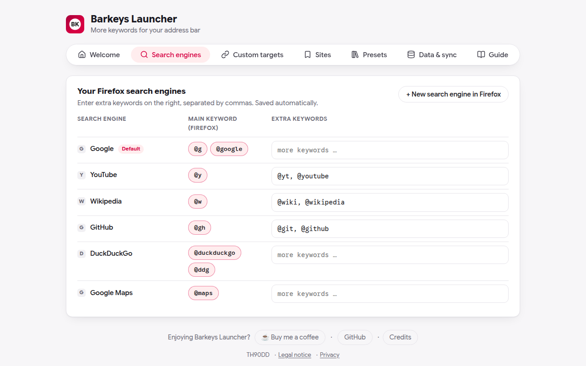
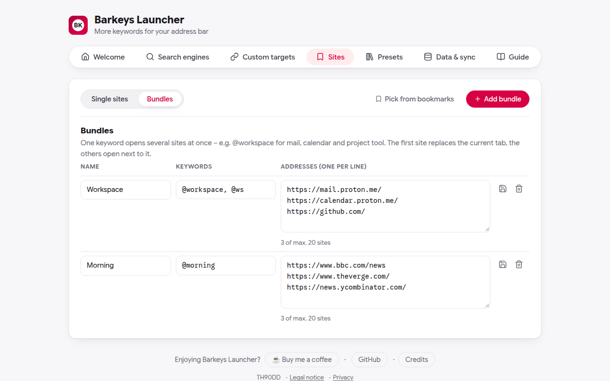
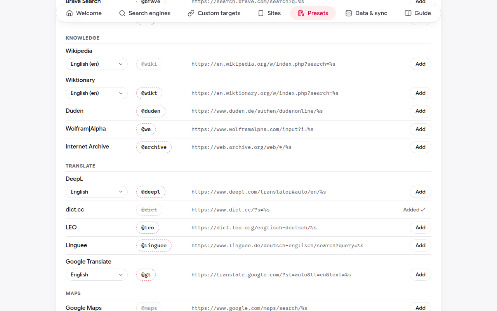
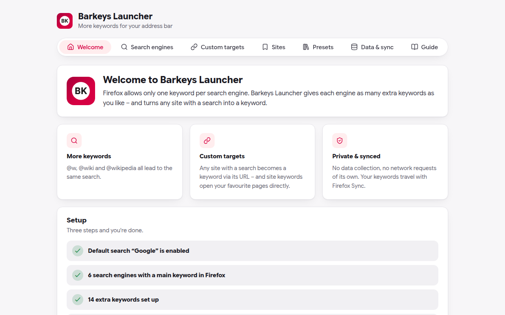

<p align="center"></p>

# Barkeys Launcher

<p align="center">
  
  
  <a href="https://addons.mozilla.org/de/firefox/addon/barkeys-launcher/"></a>
  
  
  
</p>

<p align="center"><a href="README.md">English</a> · <b>Deutsch</b></p>

**Mehr Kürzel für deine Firefox-Adressleiste.**

Firefox gibt jeder Suchmaschine genau **ein** Kürzel. Barkeys Launcher macht die Adressleiste zum Launcher: beliebig viele Kürzel pro Suchmaschine, jede Seite mit Suchfunktion als eigenes Kürzel, Abkürzungen zu deinen Lieblingsseiten und Bündel, die mehrere Tabs auf einmal öffnen – alles direkt in die Adressleiste getippt.

**Funktionen auf einen Blick**

- **Mehr Kürzel pro Suchmaschine** – `@w`, `@wiki` und `@wikipedia` durchsuchen alle Wikipedia.
- **Eigene Ziele** – jede Seite mit Suchfunktion wird per URL zum Kürzel, z. B. `@dict wort`.
- **Seiten-Kürzel** – `@news` öffnet direkt deine Nachrichtenseite, auf Wunsch aus deinen Lesezeichen gewählt.
- **Bündel** – `@workspace` öffnet Mail, Kalender und Projekt-Tool auf einmal.
- **45+ Vorlagen** – Wikipedia, DeepL, Amazon, GitHub, Flathub und mehr, mit Länder- und Sprachvarianten.
- **Sync, Backup & Teilen** – Kürzel reisen per Firefox Sync mit; Export/Import als Datei.
- **Datenschutz eingebaut** – keine Datensammlung, keine eigenen Netzwerkverbindungen, optionale Rechte nur, wenn du eine Funktion nutzt.
- **Deutsch & Englisch** – folgt der Sprache deines Firefox, oder du wählst selbst.

Barkeys Launcher **erweitert** deine Firefox-Suchmaschinen, es ersetzt sie nicht.

> **Ein Nebenprojekt.** Ich habe Barkeys Launcher für meinen eigenen Bedarf gebaut und teile es, weil es anderen vielleicht auch hilft. Updates und neue Funktionen kommen nach eigenem Ermessen, ohne festen Zeitplan oder zugesicherten Support, und es kann Fehler enthalten. Die Nutzung erfolgt *ohne Gewähr* – siehe [MPL-2.0](LICENSE). Fehlerberichte und Ideen sind über [Issues](https://github.com/TH90DD/barkeys-launcher/issues) willkommen.

## Installation

Barkeys Launcher gibt es **ausschließlich über [addons.mozilla.org](https://addons.mozilla.org/)** – den offiziellen Firefox-Add-on-Store, mit automatischen Updates und Mozillas Prüfung.

**➜ [Barkeys Launcher für Firefox holen](https://addons.mozilla.org/de/firefox/addon/barkeys-launcher/)**

Bitte installiere keine Versionen aus anderen Quellen. Entwickler können den Code zum Testen vorläufig laden – siehe [Entwicklung](#entwicklung).

## So funktioniert's

| Suchmaschine | Haupt-Kürzel (in Firefox) | Weitere Kürzel (in Barkeys Launcher) |
|---|---|---|
| YouTube | `@y` | `@yt`, `@youtube` |
| Wikipedia | `@w` | `@wiki`, `@wikipedia` |

1. Du tippst `@wiki katzen` in die Adressleiste.
2. Firefox kennt `@wiki` nicht und schickt den Text an deine Standardsuchmaschine.
3. Barkeys Launcher fängt diese Ergebnisseite ab, bevor sie lädt, und übergibt die Suche stattdessen an deine Firefox-Suchmaschine „Wikipedia“.

### Screenshots

<table>
  <tr>
    <td align="center" width="50%"><b>Weitere Kürzel für deine Suchmaschinen</b><br><br></td>
    <td align="center" width="50%"><b>Bündel: ein Kürzel, mehrere Tabs</b><br><br></td>
  </tr>
  <tr>
    <td align="center" width="50%"><b>45+ Vorlagen mit Länder- &amp; Sprachvarianten</b><br><br></td>
    <td align="center" width="50%"><b>Willkommen-Tab mit Einrichtungs-Checkliste</b><br><br></td>
  </tr>
</table>

### Gut zu wissen

- **Namensanzeige nur fürs Haupt-Kürzel.** Beim Tippen von `@w ` zeigt Firefox „Wikipedia ד. Bei weiteren Kürzeln steht dort „Mit Google suchen“ – Barkeys Launcher greift erst nach Enter ein, weil Add-ons die Adressleiste nicht verändern dürfen. Tipp: Nimm das Kürzel, das du am häufigsten tippst, als Haupt-Kürzel in Firefox; Barkeys Launcher ist das Sicherheitsnetz für den Rest.
- **Einstellungen:** Klick auf den BK-Knopf in der Toolbar (oder im Erweiterungs-Menü anheften).
- **Add-ons können keine Firefox-Suchmaschinen anlegen.** Du legst die Suchmaschine einmal unter Firefox-Einstellungen → Suche an; Barkeys Launcher erkennt sie automatisch.

## Rechte & Datenschutz

| Recht | Wofür |
|---|---|
| `search` | Deine Firefox-Suchmaschinen auflisten und damit suchen |
| `storage` | Deine Kürzel speichern (per Firefox Sync, falls aktiv) |
| `webRequest`, `webRequestBlocking` | Die Ergebnisseite der Standardsuche abfangen und umleiten |
| `bookmarks` (optional) | Nur wenn du bei Seiten „Aus Lesezeichen wählen“ nutzt; Suche läuft lokal |
| Zugriff auf *eine* Suchseite (optional) | Nur die Ergebnisseite der Standardsuche, die du in den Einstellungen freigibst, z. B. `www.google.com/search` |

Keine Datensammlung, keine Statistik, keine eigenen Netzwerkverbindungen. Alle Details: [PRIVACY.de.md](PRIVACY.de.md).

**Sicherheit**

- Alles, was aus dem Speicher, aus Sync oder einer Import-Datei kommt, wird geprüft: Kürzel (Länge, keine Leerzeichen), Namen und Such-URLs (nur `http(s)`, müssen `%s` enthalten). Ungültiges wird verworfen, nie ausgeführt.
- Umgeleitet wird ausschließlich auf `http(s)`-Adressen; Suchbegriffe werden URL-kodiert.
- Die Einstellungsseite setzt Texte nur per `textContent` – kein `innerHTML`.
- Suchmaschinen-Icons werden nur angezeigt, wenn sie eingebettet sind (`data:` usw.) – das Öffnen der Einstellungen kontaktiert keine Webseite.
- Gespeichert wird ein kleiner Eintrag pro Ziel, weit innerhalb der Sync-Grenzen (8 KB pro Eintrag, 100 KB gesamt).

## Sync, Backup & Teilen

Kürzel liegen in `storage.sync` und reisen per Firefox Sync mit (wenn „Add-ons“ aktiviert ist). Eigene Suchmaschinen synchronisiert Firefox selbst nicht; Barkeys Launcher zeigt Kürzel fehlender Suchmaschinen unter *Nicht in Firefox gefunden*. Export/Import (JSON) funktioniert ohne Sync und kann die Such-URLs mitnehmen, um Suchmaschinen auf einem neuen Gerät anzulegen.

## Mitmachen

Issues und Pull Requests sind willkommen – siehe [CONTRIBUTING.md](CONTRIBUTING.md).

## Sprachen & Übersetzungen

Die Einstellungen folgen automatisch der Sprache von Firefox; unter *Daten & Sync → Sprache* kannst du eine feste wählen. Aktuell: **Deutsch** und **Englisch**.

Du möchtest eine Sprache ergänzen? Kopiere `_locales/en/messages.json` nach `_locales/<code>/messages.json` (z. B. `fr`), übersetze die `message`-Werte (`$Platzhalter$` und `%s` bitte unverändert lassen), trage die Sprache in `BK.LOCALES` in `lib/constants.js` ein und öffne einen Pull Request.

## Entwicklung

```bash
node --test 'tests/*.test.mjs'   # Unit-Tests für Speicher, Import-Prüfung und Umleitung
npx web-ext lint
npx web-ext run      # startet ein Test-Firefox mit dem Add-on
npx web-ext build    # ZIP in web-ext-artifacts/
tools/sign.sh        # über addons.mozilla.org signieren (fragt API-Schlüssel verdeckt ab)
```

Oder vorläufig laden: `about:debugging#/runtime/this-firefox` → „Temporäres Add-on laden…“ → `manifest.json`.

## Ausblick

- Live-Vorschläge in der Adressleiste über ein eigenes Schlüsselwort
- Schlauere Lesezeichen-Suche
- Bündel aus einem Lesezeichen-Ordner

## Unterstützen

Wenn dir Barkeys Launcher ein paar Tastendrücke spart, freue ich mich über einen [Kaffee ☕](https://buymeacoffee.com/th90dd).

## Rechtliches

Herausgegeben von TH90DD · [Impressum](https://th90dd.com/impressum) · [Datenschutz](PRIVACY.de.md)

## Lizenz

[MPL-2.0](LICENSE) © TH90DD · Oberflächen-Icons von [Lucide](https://lucide.dev) (ISC), siehe [THIRD_PARTY_NOTICES.md](THIRD_PARTY_NOTICES.md).
