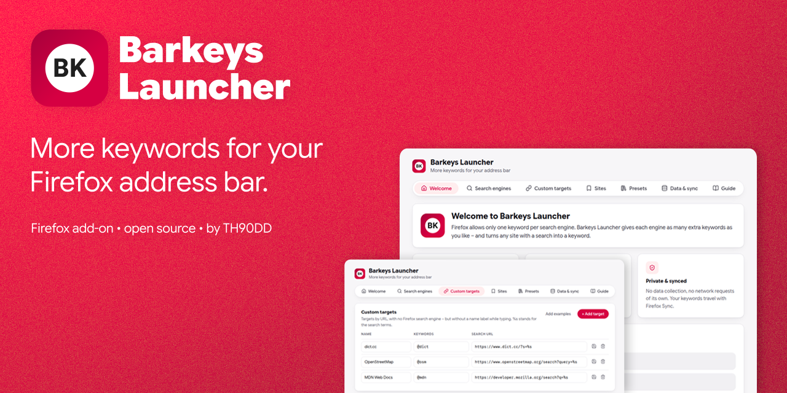
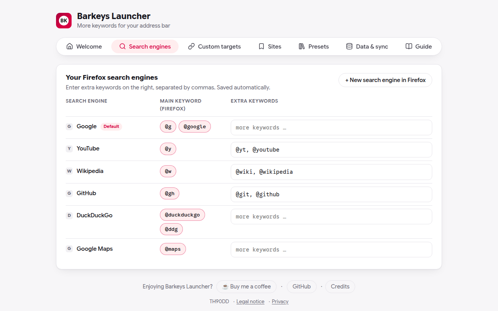
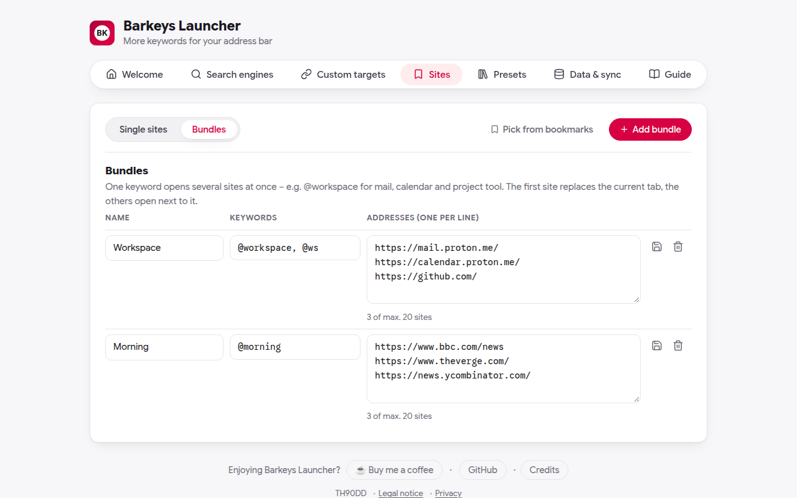
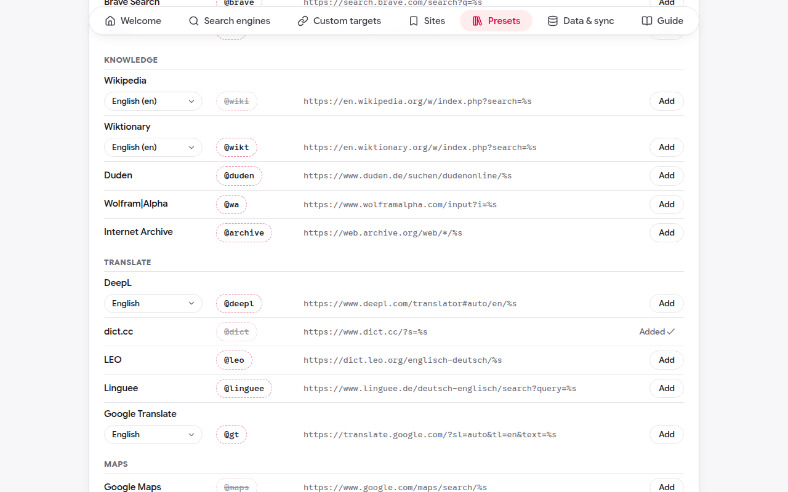
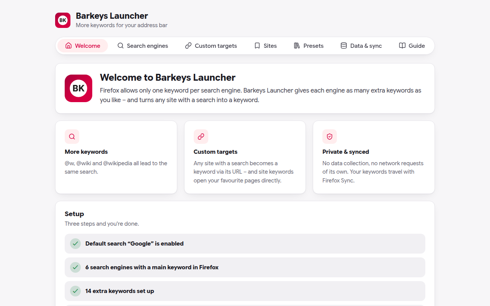

<p align="center"></p>

# Barkeys Launcher

**English** · [Deutsch](README.de.md)

**Smarter search with address bar keywords.**

Firefox lets you give each search engine exactly **one** keyword. Barkeys Launcher adds as many extra keywords as you like – `@w`, `@wiki` and `@wikipedia` all search Wikipedia.

It **extends** your Firefox search engines, it doesn't replace them.

> **A side project.** I built Barkeys Launcher for my own needs and share it because others might find it useful. Updates and new features happen at my own discretion, without a fixed schedule or guaranteed support, and it may contain bugs. It's provided *as is*, without warranty – see the [MPL-2.0](LICENSE). Bug reports and ideas are welcome via [issues](https://github.com/TH90DD/barkeys-launcher/issues).

## How it works

| Search engine | Main keyword (set in Firefox) | Extra keywords (set in Barkeys Launcher) |
|---|---|---|
| YouTube | `@y` | `@yt`, `@youtube` |
| Wikipedia | `@w` | `@wiki`, `@wikipedia` |

1. You type `@wiki cats` into the address bar.
2. Firefox doesn't know `@wiki`, so it sends the text to your default search engine.
3. Barkeys Launcher catches that result page before it loads and hands the search to your Firefox engine "Wikipedia" instead.

You can also add targets that have no Firefox search engine at all, just a URL with `%s` – **site keywords** that open a page directly (`@news` → your news site), optionally picked from your bookmarks, and **bundles** that open several sites at once (`@workspace` → mail, calendar, project tool). The guide includes ~45 ready-made search presets (Wikipedia, DeepL, Amazon, GitHub, Flathub, …) you can add with one click.

### Screenshots

<table>
  <tr>
    <td align="center" width="50%"><b>Extra keywords for your search engines</b><br><br></td>
    <td align="center" width="50%"><b>Bundles: one keyword, several tabs</b><br><br></td>
  </tr>
  <tr>
    <td align="center" width="50%"><b>45+ presets with country &amp; language variants</b><br><br></td>
    <td align="center" width="50%"><b>Welcome tab with setup checklist</b><br><br></td>
  </tr>
</table>

### Good to know

- **Name label only for the main keyword.** While typing `@w `, Firefox shows "Wikipedia ×". For extra keywords it shows "Search with Google". Barkeys Launcher only steps in after you press Enter, because add-ons can't change the address bar. Tip: use the keyword you type most as the main keyword in Firefox, and let Barkeys Launcher be the safety net for the rest.
- **Settings:** click the BK button in the toolbar (or pin it from the extensions menu).
- **Add-ons can't create Firefox search engines.** You add the engine once in Firefox Settings → Search; Barkeys Launcher picks it up automatically.

## Permissions & privacy

| Permission | Why |
|---|---|
| `search` | List your Firefox search engines and run searches with them |
| `storage` | Save your keywords (synced via Firefox Sync if enabled) |
| `webRequest`, `webRequestBlocking` | Catch the default engine's result page and redirect it |
| `bookmarks` (optional) | Only when you use “Pick from bookmarks” for site keywords; searched locally |
| Access to *one* search site (optional) | Only the result page of the default engine you enable in the settings, e.g. `www.google.com/search` |

No data collection, no analytics, no network requests of its own. Full details: [PRIVACY.md](PRIVACY.md).

**Security notes**

- Everything read from storage, Sync or an import file is validated: keywords (length, no spaces), names, and search URLs (`http(s)` only, must contain `%s`). Invalid entries are dropped, never executed.
- Redirects only ever go to `http(s)` URLs; search terms are URL-encoded.
- The options page builds its UI with `textContent` only – no `innerHTML`.
- Search engine icons are only shown if they're embedded (`data:` etc.), so opening the settings never contacts a website.
- Data is stored as one small item per entry, well within Firefox Sync's limits (8 KB per item, 100 KB total).

## Sync, backup & sharing

Keywords are stored in `storage.sync`, so they follow you via Firefox Sync (with “Add-ons” enabled). Firefox doesn't sync custom search engines itself; Barkeys Launcher lists keywords of missing engines under *Not found in Firefox*. Export/import (JSON) works without Sync and can carry the engines' search URLs to set them up on a new device.

## Development

```bash
node --test tests/   # unit tests for storage, import validation and redirects
npx web-ext lint
npx web-ext run      # starts a test Firefox with the add-on
npx web-ext build    # zip in web-ext-artifacts/
tools/sign.sh        # sign via addons.mozilla.org (asks for API credentials, hidden)
```

```
lib/        shared core: constants, validation, storage (sync schema v2), keyword resolver
background.js   intercepts the default engine's result page and redirects
options/    settings UI: one file per tab (welcome, engines, custom, sites, presets, data) + guide in HTML
_locales/   UI translations (de, en)
tests/      node:test unit tests (not shipped in the add-on)
```

Or load it temporarily: `about:debugging#/runtime/this-firefox` → "Load Temporary Add-on…" → `manifest.json`.

## Contributing

Issues and pull requests are welcome – see [CONTRIBUTING.md](CONTRIBUTING.md).

## Languages & translations

The settings follow Firefox's language automatically; under *Data & sync → Language* you can pick a fixed one. Currently: **English** and **German**.

Want to add a language? Copy `_locales/en/messages.json` to `_locales/<code>/messages.json` (e.g. `fr`), translate the `message` values (keep `$placeholders$` and `%s` as they are), add the language to `BK.LOCALES` in `lib/constants.js` and open a pull request.

## Roadmap

- Live suggestions in the address bar via a dedicated keyword
- Smarter bookmark search
- Bundle from a bookmark folder

## Support

If Barkeys Launcher saves you some keystrokes, you can [buy me a coffee ☕](https://buymeacoffee.com/th90dd).

## Legal

Published by TH90DD · [Legal notice](https://th90dd.com/imprint) · [Privacy policy](PRIVACY.md)

## License

[MPL-2.0](LICENSE) © TH90DD · Interface icons by [Lucide](https://lucide.dev) (ISC), see [THIRD_PARTY_NOTICES.md](THIRD_PARTY_NOTICES.md).
